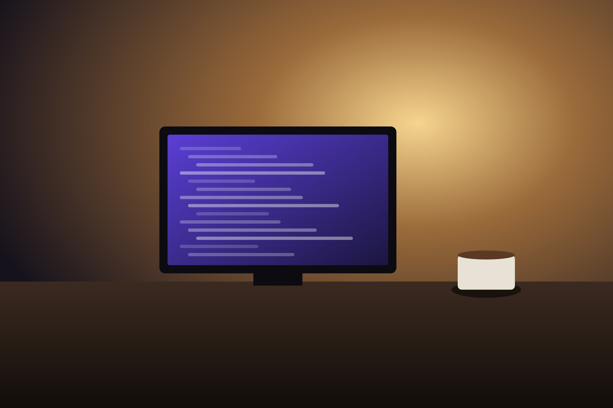
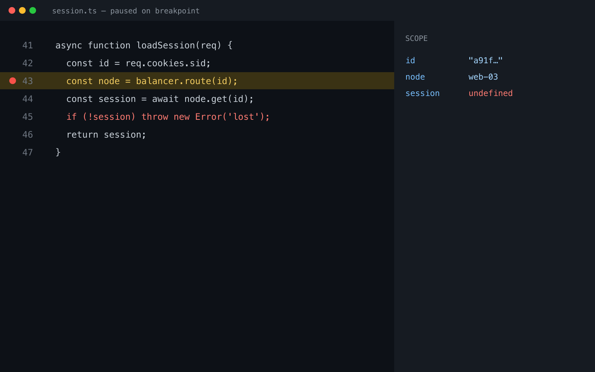

There's a particular kind of frustration that comes with staring at code that should work but doesn't. The tests fail. The console screams errors. And you, the developer, sit there wondering if you've chosen the right career.

But over time, I've learned to reframe debugging from a chore into an art form — a practice that, when approached with the right mindset, becomes one of the most satisfying parts of development.

## The Shift in Perspective

Early in my career, bugs felt personal. Each one was evidence of my inadequacy, proof that I didn't belong in this field. The breakthrough came when I started viewing bugs not as failures, but as **puzzles waiting to be solved**.

This simple reframe changed everything.

Instead of asking "Why am I so stupid?" I began asking "What story is this bug trying to tell me?" The difference is subtle but transformative. One question leads to despair; the other leads to curiosity.

## The Three-Phase Approach

After years of debugging everything from memory leaks to race conditions, I've developed a systematic approach:

### 1. Reproduce Reliably

Before anything else, you need to be able to trigger the bug consistently. This often takes longer than the actual fix, but it's non-negotiable. A bug you can't reproduce is a bug you can't truly fix.

### 2. Isolate Ruthlessly

Binary search isn't just for sorted arrays — it's for debugging too. Comment out half your code. Does the bug persist? If yes, the problem is in the remaining half. If no, it's in what you removed. Repeat until you've cornered the culprit.

### 3. Understand Before Fixing

This is where most developers go wrong. The temptation to immediately fix what looks broken is overwhelming. But resist it. Take time to understand *why* the bug exists. Often, the obvious fix only masks a deeper architectural issue.

## The Tools That Help

Good debugging is tool-assisted, not tool-dependent. Here are my essentials:

- **Console.log, strategically placed** — Yes, it's basic. It's also incredibly effective.
- **The browser's debugger** — Step through code execution to see exactly what's happening.
- **Git bisect** — When you don't know which commit introduced a bug, let Git find it for you.
- **Rubber duck debugging** — Explaining the problem out loud often reveals the solution.

## A Recent Victory

 — a portrait phone photo, rotated upright and stripped of its metadata at build time.")

Last month, I spent three days hunting a bug that only appeared in production. Users reported intermittent failures, but our monitoring showed nothing unusual.

The breakthrough came when I stopped looking at the code and started looking at the infrastructure. The bug wasn't in our application — it was in how our load balancer handled sticky sessions during deployments.

The lesson? Sometimes the bug isn't where you're looking. Expand your investigation radius.

## Embrace the Unknown

 — the text wraps around it.")

Debugging teaches humility. No matter how experienced you become, there will always be bugs that humble you, that force you to admit you don't understand something you thought you knew.

And that's okay. That's more than okay — it's the path to growth.

The next time you encounter a bug that makes you want to throw your laptop out the window, take a breath. Remember that every solved bug makes you a better developer. The frustration is temporary; the skill is permanent.

Happy debugging.
